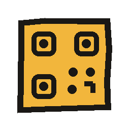
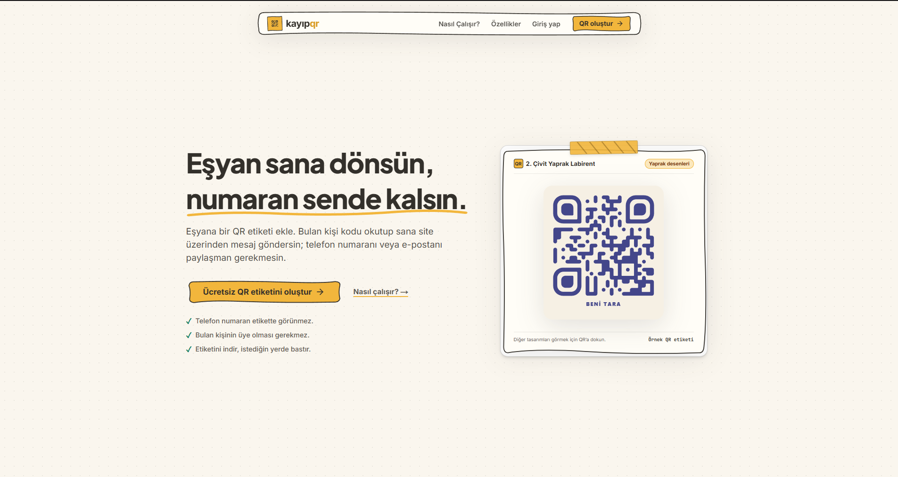
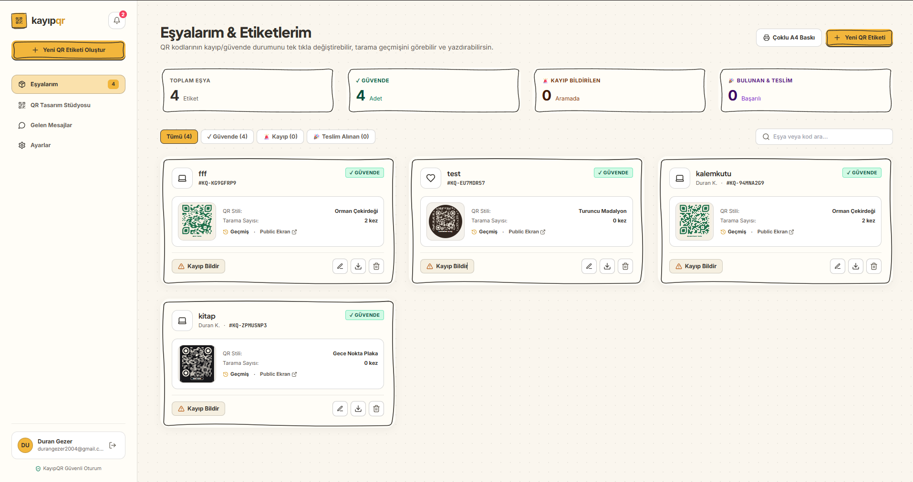
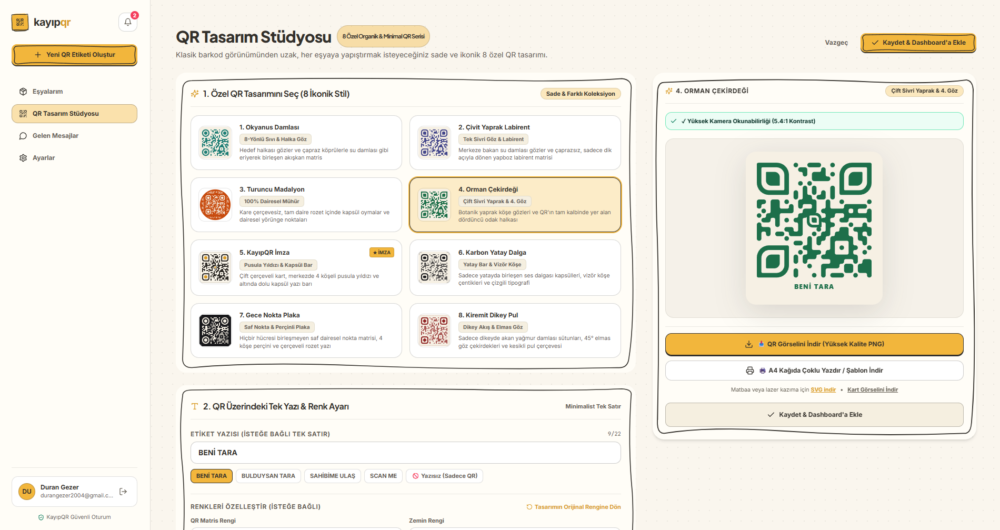
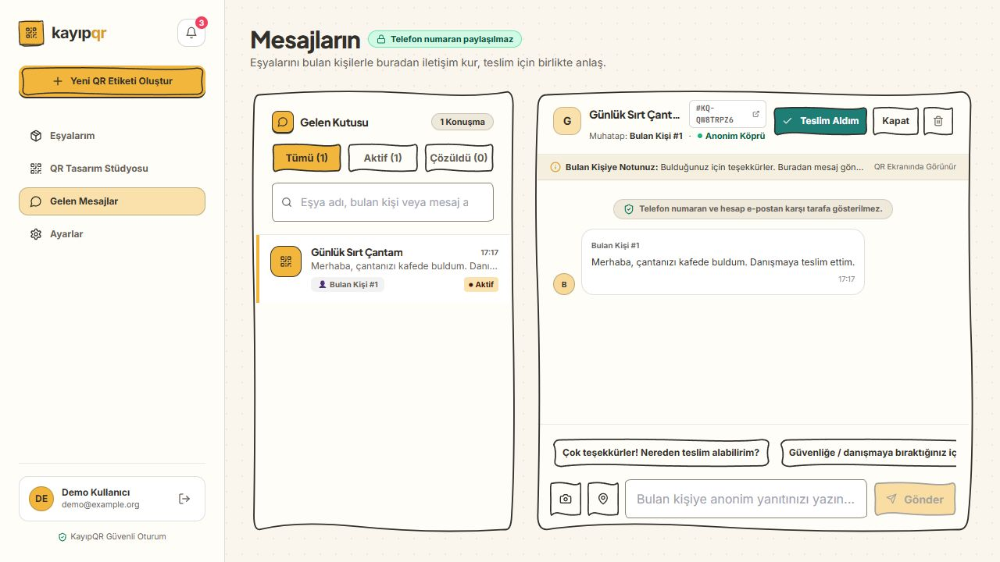
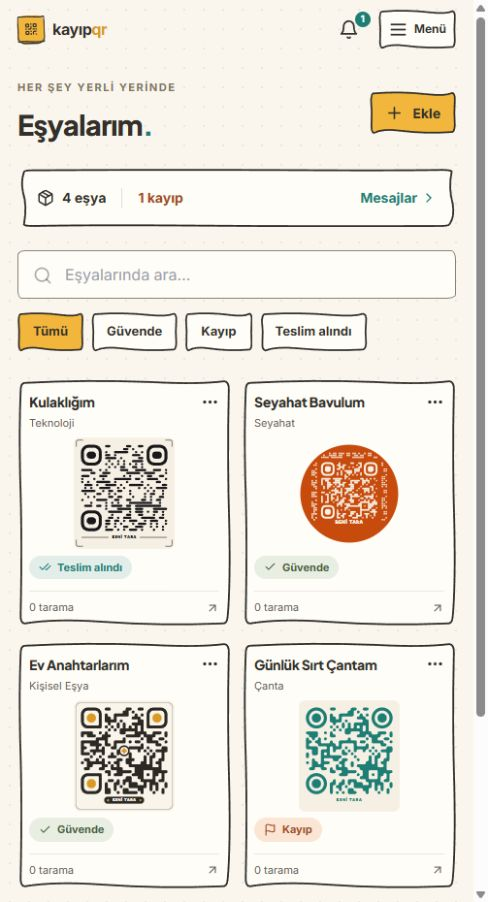
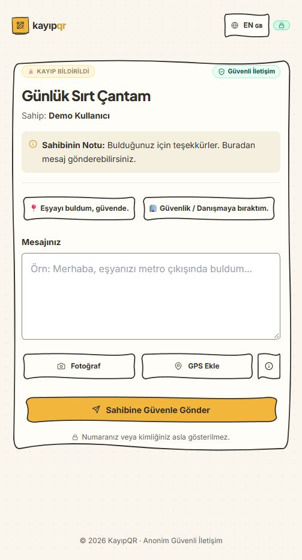
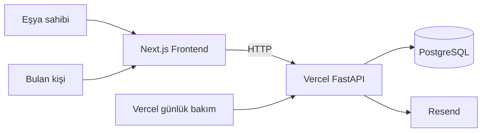

<p align="center">
  
</p>

<h1 align="center">KayıpQR</h1>
<p align="center"><strong>Eşyan sana dönsün, numaran sende kalsın.</strong></p>
<p align="center">Eşyalar için kişiselleştirilebilir QR etiketleri ve telefon numarası paylaşmadan mesajlaşma.</p>

<p align="center">
  <a href="#ekran-görüntüleri">Ekran görüntüleri</a> ·
  <a href="#yerelde-çalıştırma">Kurulum</a> ·
  <a href="#mimari">Mimari</a>
</p>



## Ne yapar?

KayıpQR, eşyanı bulan kişinin sana ulaşabileceği bir web sayfasını QR etiketine bağlar. Eşya sahibi etiketini tasarlayıp indirir ve kendi tercih ettiği şekilde bastırır. Bulan kişi QR'ı tarar; hesap açmadan veya uygulama indirmeden mesaj gönderir. İletişim için hesap e-postasının ya da telefon numarasının etikette görünmesi gerekmez.

**Akış:** Eşyanı ekle → QR etiketini tasarla → İndir ve bastır → Bulan kişi tarayıp mesaj göndersin → Hesabından yanıtla.

KayıpQR bir GPS takip cihazı değildir; eşyanın bulunmasını veya geri dönmesini garanti etmez. Fiziksel etiket gönderimi yapmaz. Sayfayı açmak ve mesajlaşmak için internet gerekir.

## Özellikler

- **QR tasarım stüdyosu:** Sekiz tasarım, renk ve etiket metni seçenekleri; PNG/SVG indirme, A4 yerleşimleri ve yazdırma/PDF kaydetme akışı.
- **Eşya yönetimi:** Güvende, kayıp ve teslim alındı durumları; etiket yayınını duraklatma; bilgileri mevcut QR bağlantısını değiştirmeden güncelleme.
- **Bulan kişi sayfası:** Üyeliksiz ilk mesaj, fotoğraf ekleme, isteğe bağlı konum paylaşımı, özel sohbet bağlantısını kopyalama ve Türkçe/İngilizce arayüz. İsteğe bağlı e-posta adresi eşya sahibine gösterilmez.
- **Sohbet:** Fotoğraf, konum ve okundu bilgisi; Vercel profilinde görünür sekmede periyodik güncelleme. Sürekli çalışan backend için WebSocket seçeneği.
- **Tarama geçmişi:** Tarama zamanı, cihaz bilgileri ve mevcutsa yaklaşık bölge; harici GeoIP varsayılan olarak kapalıdır.
- **Bildirimler:** Site içi bildirim listesi, desteklenen tarayıcılarda izinle açık sayfa bildirimi ve her yeni konuşmanın ilk mesajında sahibine tercihe bağlı e-posta. Bulan kişi adresini bırakırsa sahibin ilk cevabında, aynı sohbete dönmesini sağlayan özel bağlantıyla tek bir e-posta alır. QR taramalarında ve sonraki mesajlarda e-posta gönderilmez. Her alıcı rolü için aynı adrese 15 dakikada en fazla 1, 24 saatte en fazla 10 bildirim sınırı uygulanır.
- **Mobil web:** İki sütunlu eşya kartları, ilk altı karttan sonra “Hepsini göster”, açılır hesap menüsü ve dokunmaya uygun kontroller.

### Bildirimlerin sınırları

Vercel profilinde açık sohbet yaklaşık 15, konuşma listesi 30, zil 60 saniyede bir güncellenir; gizli sekmelerde kontroller durur. Sohbet açılışından sonraki yenilemeler son mesajdan sonraki kayıtları alır; eski fotoğraf imzaları süresi dolmadan yenilenir. Sohbet fotoğrafları 30 gün sonrasındaki günlük bakımda kaldırılır, yazılı mesajlar kalır. Tarayıcı bildirimi destek ve izin gerektirir; site kapalıyken çalışan Web Push altyapısı bulunmaz. E-posta için Resend veya uygun dağıtımda SMTP ayarları gerekir. Yerel varsayılan ayarlar gerçek e-posta göndermez.

Telefon numarası ve hesap e-postası herkese açık eşya yanıtında yer almaz. Paylaşmayı seçtiğin sahip adı, eşya bilgileri ve mesaj içine kendin yazdığın bilgiler karşı tarafa görünebilir. Mesajlaşma için uçtan uca şifreleme iddiası bulunmaz.

## Ekran görüntüleri

Ana sayfa, masaüstü eşya paneli ve QR stüdyosu görselleri proje sahibinin paylaştığı geniş ekran görüntüleridir. Mesajlaşma ve mobil görseller ayrı bir yerel veritabanındaki **kurgu demo verilerini** kullanır.

### Eşya paneli



### QR tasarım stüdyosu



### Mesajlaşma



### Mobil görünüm

**Eşyalarım**



**Bulan kişi sayfası**



## Teknolojiler

| Katman | Kullanılanlar |
|---|---|
| Web arayüzü | Next.js 15 App Router, React 18, TypeScript |
| Tasarım | Tailwind CSS, Framer Motion, Lucide, ortak SVG çerçeveler |
| API | FastAPI, Pydantic, async SQLAlchemy, Alembic |
| Kimlik doğrulama | JWT, Argon2id; eski bcrypt hash'leri için geçiş desteği |
| Veritabanı | Yerelde SQLite, dağıtımda PostgreSQL |
| Paylaşılan durum | Vercel'de PostgreSQL üzerinde ortak istek sınırları |
| Dosyalar | Vercel'de PostgreSQL içinde sıkıştırılmış WebP; yerelde klasör |
| E-posta | SQL outbox, Resend HTTPS API; istek içi gönderim ve günlük yeniden deneme |
| Dağıtım | Vercel yapılandırmaları; alternatif Docker/Railway dosyaları |

## Mimari



Vercel profilinde mesajlar, sıkıştırılmış fotoğraflar, istek sayaçları ve e-posta kuyruğu PostgreSQL'de saklanır. Redis, Bucket ve ayrı worker gerekmez. Kurulum ve mevcut verileri taşıma adımları: [Vercel rehberi](Backend/VERCEL.md).

## Yerelde çalıştırma

Gereksinimler: **Node.js 20**, **Python 3.11+** ve Git. Docker dosyaları Python 3.11 / Node.js 20 kullanır. Basit geliştirme için PostgreSQL, Redis veya Bucket kurmak gerekmez; SQLite ve yerel depolama kullanılabilir.

### 1. Backend

Depo kökünden PowerShell:

```powershell
cd Backend
python -m venv venv
.\venv\Scripts\python.exe -m pip install -r requirements.lock
Copy-Item .env.example .env
.\venv\Scripts\python.exe -m uvicorn app.main:app --reload --host 127.0.0.1 --port 8000
```

`.env` zaten varsa kopyalama adımını atla; kendi ayarlarının üzerine yazma. Yeni ortamda `SECRET_KEY` için `python -c "import secrets; print(secrets.token_hex(32))"` ile rastgele bir değer üret ve yalnızca `.env` dosyana kaydet.

macOS/Linux karşılıkları: `venv/bin/python`, `cp .env.example .env`.

Geliştirme ortamında eksik tablolar başlangıçta oluşturulur. Mevcut şemayı değiştiren güncellemelerde, veritabanını yedekleyip `python -m app.migrate` çalıştır. Production/staging şeması Alembic ile yönetilir.

### 2. Frontend

İkinci terminalde depo kökünden:

```powershell
cd Frontend
npm ci
Copy-Item .env.example .env.local
npm run dev
```

| Adres | Amaç |
|---|---|
| `http://localhost:3000` | Web sitesi |
| `http://127.0.0.1:8000/docs` | Geliştirme API dokümantasyonu |
| `http://127.0.0.1:8000/health` | Process canlılık kontrolü |
| `http://127.0.0.1:8000/ready` | Bağımlılıkların hazır olma kontrolü |

İlk hesabını kayıt sayfasından oluştur ve e-postana gelen bağlantıyla doğrula. Gerçek e-posta için Resend veya SMTP yapılandırması gerekir. Google ile giriş kurulumu: [Google rehberi](Backend/GOOGLE_AUTH.md). Depoda hazır giriş bilgileri veya gerçek kullanıcı veritabanı bulunmaz.

### Ortam değişkenleri

| Dosya | Amaç |
|---|---|
| [Backend/.env.example](Backend/.env.example) | Yerel API ayarları |
| [Frontend/.env.example](Frontend/.env.example) | Frontend'in API, WebSocket ve site adresleri |
| [Backend/vercel.env.example](Backend/vercel.env.example) | PostgreSQL depolamalı Vercel backend ayarları |
| [Frontend/vercel.env.example](Frontend/vercel.env.example) | Vercel frontend build ayarları |
| [Backend/railway.env.example](Backend/railway.env.example) | Railway servis referansları ve production ayarları |
| [.env.example](.env.example) | Kök Docker Compose değişkenleri |

`NEXT_PUBLIC_*` değişkenleri tarayıcıya açıktır ve build sırasında frontend'e alınır. Bu alanlara veritabanı, Bucket, e-posta veya JWT anahtarı koyma. Örnek dosyalardaki geliştirme değerlerini production için kullanma.

## Kontroller

```powershell
# Backend dizininde
.\venv\Scripts\python.exe -m pip install -r requirements-dev.txt
.\venv\Scripts\python.exe -m pytest tests -q

# Frontend dizininde
node tests/api-pagination.cjs
node tests/visible-polling.cjs
node tests/message-media.cjs
npx tsc --noEmit
npm run build
```

Frontend üretim derlemesini, aynı `.next` klasörünü kullanan geliştirme sunucusu kapalıyken çalıştır.

Backend testleri varsayılan olarak geçici SQLite ve izole test dosyaları kullanır. PostgreSQL testleri CI'de gerçek test veritabanına karşı çalışır. GitHub Actions; Redis'siz HTTP mesajlaşması, PostgreSQL fotoğraf/kota testleri, alternatif Redis üzerinden iki backend testi ve Docker kontrolleri içerir. S3 protokol testi isteğe bağlıdır; test servisi tanımlanmamışsa atlanır. Bir workflow dosyasının bulunması bu kontrollerin geçmiş olduğu anlamına gelmez.
